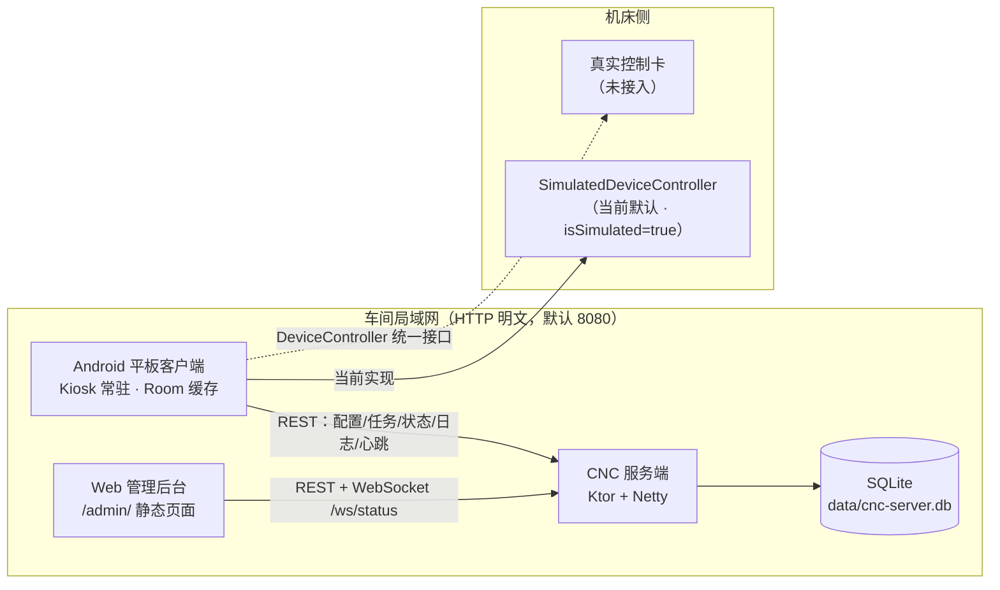

# CNC Host 数控加工上位机系统 — 项目文档

| 项 | 内容 |
|---|---|
| 文档版本 | 1.0 |
| 生成日期 | 2026-10-28 |
| 代码基线 | `cnc-host-git-baseline`，HEAD `b29fee1`（feat: 后台全套用户与权限管理） |
| 适用对象 | 客户、新加入开发者、现场实施与运维人员 |
| 文档依据 | 仓库内真实代码、Gradle 配置、SQLite 建表语句、单元测试结果与构建日志；不含推测性功能 |

> 说明：本文档中标注「（需现场确认）」的内容，表示代码中无法完全确定，或依赖具体平板型号、网络环境、控制卡型号，需要现场实测后补充。

---

## 1. 项目概述

### 1.1 业务背景

CNC Host 面向 **X/Z 两轴数控车床** 的加工现场，提供一套「平板上位机 + 局域网服务端 + 网页管理后台」的 C/S 系统。设计目标是降低一线操作工的使用门槛，同时把工艺参数、刀具、材料、图纸、任务等配置权收归服务端统一管理，避免现场误改。

### 1.2 系统组成

| 组成 | 形态 | 运行位置 | 主要职责 |
|---|---|---|---|
| Android 客户端 | 横屏工业平板 App（Kotlin + Compose） | 机床旁平板 | Kiosk 常驻、选任务、预览下发、运行监控、报警查看；缓存服务端配置，断网可继续使用缓存 |
| 局域网服务端 | Kotlin JVM + Ktor 独立进程 | 车间服务器 / 工控机 | 配置与任务 REST API、设备激活/心跳、状态 WebSocket、SQLite 持久化、APK 发布 |
| Web 管理后台 | 服务端内置静态页面（`/admin/`） | 浏览器 | 维护刀具/材料/零件/毛坯/工艺/图纸，管理设备与功能权限、用户与角色、任务记录、客户端版本发布 |
| 控制卡 | 硬件（尚未接入） | 机床电柜 | 运动、主轴、IO、报警的真实执行机构；当前由模拟器代替 |

### 1.3 目标场景

- **操作工**：只使用简易模式 4 个页签（任务 → 预览下发 → 运行监控 → 报警状态），不接触工艺参数编辑。
- **设备管理员 / 工艺员**：通过 PIN 进入高级模式，查看图纸、CAM、仿真、审核、IO、历史等。
- **厂级管理员 / 售后**：通过 Web 后台维护主数据，查看哪台平板属于哪个单位、是否在线、客户端版本，并按设备开关功能。
- **系统集成 / 二次开发**：通过 REST 接口对接 MES、ERP 或后续真实控制卡。

---

## 2. 系统架构

### 2.1 架构图



### 2.2 数据流说明

**配置下行（服务端权威）**

1. 管理员在 Web 后台新增/修改刀具、材料、零件、毛坯、工艺方案、图纸或设备通讯参数。
2. 服务端在同一个事务中写入 SQLite，并执行 `bumpVersion()` 使 `meta.config_version` 加 1。
3. 平板每 10 秒心跳，同时调用 `GET /api/v1/config/version` 做轻量探测。
4. 版本不一致时调用 `GET /api/v1/config` 拉取完整快照，由 `ConfigSyncer.apply()` 在 Room 事务中整表替换（图纸只替换 `source = SERVER` 的记录，本地导入图纸保留）。
5. 本地 `sync_meta.config_version` 更新，界面读取 Room 展示；断网时继续使用上次缓存。

**任务与日志上行**

1. 加工开始/结束由 `SimpleRunController` 生成 `TaskHistoryEntity`，先落本地 Room。
2. 在线时 `POST /api/v1/tasks` 上传；失败或未配置时写入本地待补传队列（上限 100 条，超限丢弃最旧）。
3. 加工过程中逐段调用 `POST /api/v1/status` 上报实时状态，服务端转发给管理后台 WebSocket。
4. 操作日志先写本地 `operation_logs` 表，心跳成功后每轮最多补传 200 条到 `POST /api/v1/logs`。

**安全边界**

急停、限位、运动下发完全在客户端本地执行，不依赖服务端在线；服务端离线只影响配置更新与记录上报，不影响现场停机与安全动作。

---

## 3. 技术栈与版本

| 层 | 技术 | 版本 | 说明 |
|---|---|---|---|
| 构建工具 | Gradle Wrapper | 8.14.6 | `gradle/wrapper/gradle-wrapper.properties` |
| Android 构建插件 | AGP | 8.7.2 | `build.gradle.kts` |
| 语言 | Kotlin | 2.0.21 | 客户端、服务端统一 |
| JVM | JDK / jvmTarget | 17 | `compileOptions`、`jvmToolchain(17)` |
| Android SDK | compileSdk / targetSdk | 34 | `app/build.gradle.kts` |
| Android SDK | minSdk | 24（Android 7.0） | 工业平板兼容下限 |
| 客户端版本 | versionCode / versionName | 3 / 1.2.0 | `app/build.gradle.kts` |
| UI | Jetpack Compose | BOM 2024.09.03（app）/ 2024.10.01（core-ui） | Material3、material-icons-extended |
| 导航 | Navigation Compose | 2.8.4 | 简易/高级双模式导航 |
| 生命周期 | lifecycle-runtime-ktx / viewmodel-compose | 2.8.7 | — |
| Activity | activity-compose | 1.9.3 | — |
| 本地数据库 | Room（runtime/ktx/compiler） | 2.6.1（kapt） | 数据库 `cnc_host.db`，schema version 5 |
| JSON（客户端） | Gson | 2.10.1 | 设备/配置 DTO 序列化 |
| 服务端框架 | Ktor（Netty 引擎） | 2.3.12 | Core/Netty/ContentNegotiation/CORS/WebSockets/StatusPages/Auth/CallLogging |
| 服务端序列化 | kotlinx.serialization-json | 1.7.3 | 与 Ktor 集成 |
| 服务端数据库 | SQLite JDBC（org.xerial） | 3.46.1.3 | 直接 JDBC，无 ORM |
| 服务端日志 | Logback | 1.5.6 | — |
| 服务端版本 | group / version | `com.cnc.server` / 1.0.0 | `server/build.gradle.kts` |
| 单元测试 | JUnit 4 | 4.13.2 | 客户端模块；服务端使用 Kotlin Test + JUnit Platform |
| 协程测试 | kotlinx-coroutines-test | 1.9.0 | 各 JVM 模块 |

---

## 4. 代码结构

### 4.1 仓库目录树（关键层级）

```
cnc-host-git-baseline/
├── app/                         Android 客户端（Compose）
│   └── src/main/java/com/cnc/host/
│       ├── MainActivity.kt      Kiosk 沉浸式、双模式导航、首启引导入口
│       ├── CncApplication.kt    Room 初始化、心跳、崩溃重启
│       ├── receiver/            BootReceiver（开机自启）
│       ├── service/             KioskService（前台看门狗）
│       ├── setup/               SetupPrefs、DeviceHeartbeat、WifiSetup、KioskPermissions
│       ├── sync/                ServerApi、ConfigSyncer、SyncManager、ServerPrefs、ServerAddress
│       ├── persistence/         Room：Entities/Daos/CncDatabase/SeedData
│       ├── logging/             LogRecorder、LogDao、LogEntity
│       ├── update/              AppUpdate、AppUpdateDialog
│       ├── simple/              SimpleRunController、SimpleTaskSession
│       ├── data/                DeviceRepository（模拟设备单例）
│       ├── navigation/          Screen 路由与简易/高级导航项
│       └── ui/                  simple（4 屏）、advanced（19 屏）、components（内嵌键盘等）
├── core-model/                  纯 Kotlin 数据模型
├── core-ui/                     Android Library：工业 HMI 主题与组件
├── device-api/                  纯 Kotlin：DeviceController / CommandQueue 抽象
├── device-simulator/            纯 Kotlin：模拟控制卡、命令队列、自动化流程、日志
├── dxf-parser/                  纯 Kotlin：DXF → 几何模型
├── cam-engine/                  纯 Kotlin：轮廓提取、车削刀路生成
├── gcode-post/                  纯 Kotlin：Fanuc 0i / Siemens 840D 后处理
├── server/                      独立 Gradle 工程：Ktor 服务端 + 静态后台
│   └── src/main/
│       ├── kotlin/com/cnc/server/  Main/Database/Routes/Models/ApkPublish/StatusHub
│       └── resources/static/       index.html / app.js / style.css
├── docs/                        产品需求规格说明书、本文档
├── data/                        运行期数据（cnc-server.db、apk/）
├── gradlew / gradlew.bat        Gradle Wrapper
└── build.gradle.kts             根构建脚本（仅 AGP/Kotlin 插件声明）
```

### 4.2 Gradle 模块职责

| 模块 | 类型 | 依赖 | 职责 |
|---|---|---|---|
| `app` | Android Application | 以下全部核心模块 | 客户端全部界面、Kiosk、激活、同步、日志、更新、Room |
| `core-model` | Kotlin JVM | 无 | 零件、刀具、材料、图纸、刀路、设备快照、报警、任务、自动化配方等统一模型 |
| `core-ui` | Android Library | Compose | 工业 HMI 配色、字体、面板与状态指示灯 |
| `device-api` | Kotlin JVM | core-model + coroutines | `DeviceController` 接口、命令定义、命令队列终态语义 |
| `device-simulator` | Kotlin JVM | core-model + device-api | 模拟运动/主轴/IO/报警、故障注入、自动化流程模拟 |
| `dxf-parser` | Kotlin JVM | core-model | 解析 LINE/ARC/CIRCLE/LWPOLYLINE；POLYLINE/SPLINE 不支持 |
| `cam-engine` | Kotlin JVM | core-model + dxf-parser | 轮廓提取、粗/精车刀路、参数校验 |
| `gcode-post` | Kotlin JVM | core-model | Fanuc / Siemens G-code 生成 |
| `server` | Kotlin JVM Application | Ktor、SQLite JDBC、Logback | REST + WebSocket + 管理后台 + SQLite；**独立 Gradle 工程**，不在根 `settings.gradle.kts` 的 include 列表中 |

> 构建注意：根工程 `settings.gradle.kts` 只 include 8 个模块，缺少 `:server`。服务端必须用 `-p server` 单独构建。

---

## 5. 客户端设计

### 5.1 Kiosk 模式

| 机制 | 实现 | 关键参数 / 行为 |
|---|---|---|
| 开机自启 | `receiver/BootReceiver` 监听 `BOOT_COMPLETED` 与 `QUICKBOOT_POWERON` | 仅 `startActivity(MainActivity)`；保活服务由 Activity 前台时再启动 |
| 前台看门狗 | `service/KioskService`（`foregroundServiceType="dataSync"`） | 常驻通知「CNC Host 运行中」；每 **700 ms** 检查 `MainActivity.isResumed` |
| 被切后台拉回 | 看门狗 `startActivity` + `MainActivity.onUserLeaveHint` 300 ms 后拉回 | 使用 `NEW_TASK / CLEAR_TOP / REORDER_TO_FRONT` |
| 闪退重启 | `CncApplication.installCrashRestartHandler()` | 默认异常处理器 + `AlarmManager` 1.5 s 后重启 + `Process.killProcess` |
| 防返回退出 | `onBackPressedDispatcher` 全局拦截 | 返回键不退出；Compose Dialog 自身返回仍有效 |
| 防多任务露出 | `android:excludeFromRecents="true"` | 从最近任务列表移除 |
| 锁屏/息屏唤醒 | `showWhenLocked="true"`、`turnScreenOn="true"` | 工业现场常电场景 |
| 沉浸式 | `enableEdgeToEdge()` + `WindowInsetsControllerCompat.hide(systemBars)` | `BEHAVIOR_SHOW_TRANSIENT_BARS_BY_SWIPE`；`onWindowFocusChanged` 时再次隐藏 |
| 屏幕常亮 | `FLAG_KEEP_SCREEN_ON` | 加工期间避免熄屏 |
| 横屏 | `android:screenOrientation="landscape"` | 固定横屏 |
| 彻底退出 | 设置面板确认后 `SetupPrefs.setExited(true)` + `KioskService.stop()` + `finishAndRemoveTask()` | 退出后看门狗不再拉起；再次点桌面图标启动时 `onCreate` 复位退出标记 |
| 后台启动保护 | `KioskService.startIfForeground()` | 只在进程处于 `IMPORTANCE_FOREGROUND` 时启动 FGS，规避 `ForegroundServiceDidNotStartInTimeException` |

**边界说明**：这是软件级 Kiosk，无法阻止用户在系统设置中「强制停止」、系统 OOM 回收或厂商 ROM 的深度清理。若要达到设备级锁定，需要 Device Owner / LockTask 模式（当前未启用）。

### 5.2 首次启动引导

首次启动由 `MainActivity` 读取 `SetupPrefs.load(context).setupCompleted` 决定是否进入引导。未激活设备先进入科技感 Splash 页（`SplashScreen`：旋转双环 + 呼吸脉冲 + 扫描线动画，「开始激活」入口，2 秒自动进入），随后引导分 **3 步**（顶部步骤条 `SetupStepIndicator` 实时标识进度）：

| 步骤 | 页面 | 内容 | 是否可跳过 |
|---|---|---|---|
| 第 1 步：网络 | `NetworkSetupScreen` + `WifiSetup` | 顶部实时显示联网状态（2 秒轮询）；「连接 WiFi / 使用移动数据」选项卡：WiFi 页扫描附近热点、App 内输密码连接，移动数据页可跳转系统数据开关；**未联网时不显示「下一步」** | 是（已联网直接下一步） |
| 第 2 步：激活 | `RegisterScreen` + `RegisterViewModel` | 省份、城市（地区）、单位名称、联系人、电话、服务器地址；提交后调用 `POST /api/v1/devices/register`；成功后绿色对勾动画并自动进入下一步 | 否（必填省份/城市/单位/联系人/电话） |
| 第 3 步：权限确认 | `PermissionsSetupScreen` + `KioskPermissions` | 确认三项配置：悬浮窗/后台弹出界面、忽略电池优化、厂商「开机自启」（配合看门狗与崩溃自动重启，保证软件始终在运行、不可退出到安卓桌面）；从系统页返回时自动刷新状态 | 是（不授权只降低保活强度） |

**服务器地址规则**

- 只填 IP 即可：`ServerAddress.normalize()` 自动补 `http://` 与 `:8080`。
- 未填地址时自动局域网搜索：对本机 WiFi `/24` 网段 1–254 并发探测 8080，请求 `/api/v1/health` 并校验响应含 `cnc-server`，连接超时 400 ms。
- 地址默认沿用上次保存值；首次安装且为空时自动触发搜索。

**激活表单与地区选择**

- 字段顺序：省份 → 城市（地区） → 单位名称 → 联系人 → 电话；服务器地址沿用上方「服务器地址规则」。
- 地区数据：客户端内置 **34 个省级行政区、361 个城市项**（`ProvinceCityData.kt`），离线可选，无需联网拉取行政区划；切换省份会清空不属于该省的城市。
- 联网前置校验：点击「激活」时先调用 `WifiSetup.isOnline()`，未联网直接拦截、不发起请求；页面提示「网络尚未连接，网络不可用，请先连接 WiFi 或移动数据」，并提供「去配置网络」入口。
- 表单校验：省份/城市必选；单位名称非空且不超过 100 字；联系人非空；电话为 10–13 位数字。

**激活成功后写入**

- `SetupPrefs`：`setupCompleted=true`、`deviceId`、单位/联系人/电话/服务器地址、权限 JSON。
- `ServerPrefs`：`baseUrl`、服务端签发的 `token`、`deviceId`、`enabled=true`。此后配置同步、任务/状态/日志上报均使用设备令牌，不再需要管理口令。

### 5.3 设备激活与心跳

| 项目 | 实现 |
|---|---|
| 硬件唯一标识 | `Settings.Secure.ANDROID_ID`（`hardwareId()`），重装/清数据后保持不变 |
| 幂等激活 | 同一 `hardwareId` 重复激活时，服务端更新单位/联系人/电话/`province`/`city`/服务端地址/版本，**保留原 `id` 与 `device_token`** 并返回 200，不再返回 409；`hardwareId` 为空时按新建处理 |
| 唯一约束 | `devices.hardware_id` 上的**部分唯一索引** `WHERE hardware_id != ''`，作为幂等激活的查询依据 |
| 设备 ID | 激活请求未带 `deviceId` 时生成 `dev-<UUID 前 8 位>`；幂等激活沿用原设备 ID |
| 设备令牌 | 激活时服务端生成 32 位随机十六进制串写入 `devices.device_token`，随激活响应返回；重复激活返回原令牌，心跳响应也携带 |
| 心跳周期 | 客户端每 **10 秒** `POST /api/v1/devices/{id}/heartbeat`，附加 `appVersion` |
| 离线判定 | 服务端 `isOnline(lastSeen)`：`now - last_seen < 25 秒`；后台设备页每 3 秒轮询 |
| 权限下发 | 心跳响应带 `ClientPermissions`，客户端写入 `SetupPrefs` 并更新 `PermissionsHolder` StateFlow |
| 令牌自愈 | 仅当本地 `ServerPrefs.token` 为空且心跳响应带 `token` 时补齐（老版本客户端升级场景） |
| 心跳副作用 | `SyncManager.refresh()`、`markOnline(true)`、探测 `config/version`、补传日志、顺带 `AppUpdate.check()`（最多 60 秒一次） |
| 设备被注销 | 心跳返回 404 时客户端**仅记录 WARN 日志**，不会自动清除激活信息；需管理员在平板设置中「清除数据重新激活」 |

**权限项与实际显隐**

服务端 `ClientPermissions` 共 11 项：`taskSelect`、`previewStart`、`monitor`、`alarms`、`advanced`、`serverSync`、`drawings`、`cam`、`machining`、`io`、`history`。

客户端目前实际执行显隐的有 5 项：简易模式 4 个页签（任务/预览下发/运行监控/报警）与「高级模式」入口；其余 6 项仅保存并展示在后台，未逐项拦截高级页面。该差异需产品确认是否为预期设计。

### 5.4 配置同步机制

| 环节 | 实现 |
|---|---|
| 版本源 | 服务端 `meta.config_version`，初始为 1；每次配置写操作在事务内 `bumpVersion()` 加 1 |
| 客户端缓存 | Room `sync_meta` 表键 `config_version`、`last_sync_at` |
| 增量判断 | 心跳中 `GET /api/v1/config/version`，与本地缓存比较；不同才触发全量 |
| 全量应用 | `GET /api/v1/config` → `ConfigSyncer.apply()` 单事务整表替换刀具/材料/零件/毛坯/工艺；图纸只删 `source=SERVER`；校正先删后写 |
| 服务端权威 | 客户端无工艺编辑入口；本地导入图纸与本地任务历史不被服务端覆盖 |
| 断网降级 | 拉取失败保留本地缓存继续加工；状态栏提示「同步失败，继续使用本地缓存」 |
| 鉴权前提 | `ServerPrefs.configured = baseUrl 非空 && token 非空`；未配置时不同步 |
| 任务补传 | 同步成功后调用 `flushPendingTasksLocked()`；任务上传失败进入 SharedPreferences 队列，最多保留 100 条 |

> 说明：`CncDatabase` 启用了 `fallbackToDestructiveMigration()` 与 `allowMainThreadQueries()`，当前为开发期策略；正式升级前需评估数据保留与主线程查询风险。

### 5.5 内嵌输入法

**为什么禁用系统 IME**

- 工业平板以触屏为主，系统输入法弹层会遮挡加工界面，且不同 ROM 键盘高度不一致，容易误触。
- Kiosk 场景需要减少用户进入系统设置/切换输入法的路径。
- 现场输入内容多为 IP、端口、电话、单位名称，用固定大按键面板更可靠。

**实现**

- `MainActivity.onCreate()` 设置 `SOFT_INPUT_STATE_ALWAYS_HIDDEN`，全局不弹系统输入法。
- `ui/components/KioskKeyboard.kt` 提供 `KioskTextField`：渲染为只读输入框，点击后弹出应用内 `KioskKeyboardDialog`。
- 键盘四个页面可互相切换：
  - **26 键拼音**（默认文本页）：QWERTY 全拼，顶部高亮拼音串 + 横向滚动候选栏（最多 9 个，点击上屏 / 空格提交首选）。
  - **9 键拼音（T9）**：3×3 数字键（数字 + 小号字母），同一数字串的多个音节候选交错排列（如 64 → 米、你、密、尼……）；`1` 轮换输入常用标点，`0` 为空格/提交首选。
  - **英文页**：QWERTY + 大小写切换 + 符号页。
  - **数字页**：0–9、`.`、`-`、`:`、`_`、`@`，带「返回」（放弃收起）与「完成」（提交收起）。
- 拼音引擎为 `ui/components/PinyinEngine.kt` + 词库 `assets/pinyin_dict.txt`（约 7 千词条，含加工中心、刀具补偿等工业词汇）；26 键走哈希精确匹配 + 前缀模糊补全，T9 走数字串索引，首次打开键盘时在 IO 线程加载（<50ms）。
- 键盘面板高度限定为屏幕高度的 94%，按键行用 weight 均分，横屏平板 9 键 5 行布局不会溢出。
- `keyboardType` 为 `Number/NumberPassword/Decimal/Phone` 时默认数字页；`Ascii/Password/Uri/Email` 默认英文页；密码框回显与面板均以 `•` 掩码。
- 当前客户端共 20 处 `KioskTextField` 调用（另有 1 处为其函数声明），覆盖激活、登录密码、IP、参数等输入。
- 手写识别未内置：需要额外集成手写模型（APK 增大约 10–50MB），如有需要可作为二期需求。

**用法（关键签名）**

```kotlin
KioskTextField(
    value = state.serverAddress,
    onValueChange = { vm.setServerAddress(it) },
    keyboardType = KeyboardType.Text,
    isPassword = false,
    label = { Text("服务器地址") }
)
```

### 5.6 APK 自动更新

| 阶段 | 实现 |
|---|---|
| 检测 | `AppUpdate.check()` 由心跳循环调用，节流 60 秒；`GET /api/v1/app-version` 返回已发布版本；`versionCode` 大于本机才提示 |
| 提示 | `AppUpdateDialog` 全局弹窗；用户点「暂不」后本次运行内不再提示同一 versionCode |
| 下载 | `GET /api/v1/app-download` 流式下载到 `cacheDir/apk/cnc-host-update.apk`，进度 0–100 |
| 校验 | 下载完成后计算 SHA-256，与发布信息中的 `sha256` 不区分大小写比较；不一致删除文件并提示 |
| 安装 | `FileProvider`（authority `${applicationId}.fileprovider`）+ `ACTION_VIEW` + `application/vnd.android.package-archive` |
| 安装期间保活 | `AppUpdate.installing = true`，看门狗与 Home 键拉回逻辑暂停，避免顶掉系统安装界面；`MainActivity.onResume` 复位 |
| 安全缺口 | 仅校验 SHA-256，且校验值经同一 HTTP 通道下发，无服务端签名验签 |

### 5.7 操作日志

| 环节 | 实现 |
|---|---|
| 本地存储 | Room `operation_logs`（id 自增、timestamp、level、category、message、taskId、details、uploaded） |
| 写入方式 | `LogRecorder.info/warn/error/debug`，IO 线程即发即忘；同一 `(category,message)` 10 秒内去重 |
| 补传 | 心跳成功后查询 `uploaded=false`，每轮最多 200 条，`POST /api/v1/logs`（设备令牌鉴权）；成功标记 `uploaded=true` |
| 失败处理 | 上传失败保留本地，下一轮继续；不做无限重试退避 |
| 关键埋点 | 应用启动、加工启动/完成/失败/受控停止/急停、心跳异常、APK 下载/安装、清除数据等 |

---

## 6. 服务端设计

### 6.1 模块与启动

入口 `server/src/main/kotlin/com/cnc/server/Main.kt`：读取环境变量 → `Db.init(dbPath)` 建库建表 → `embeddedServer(Netty, host="0.0.0.0", port=PORT)`。

| 环境变量 | 默认值 | 说明 |
|---|---|---|
| `PORT` | `8080` | HTTP 监听端口 |
| `CNC_ADMIN_TOKEN` | `cnc-admin-2026` | 部署引导管理口令；作为超管虚拟账号使用 |
| `CNC_DB` | `data/cnc-server.db` | SQLite 文件路径（相对服务工作目录） |
| `CNC_APK` | `data/apk/cnc-host-update.apk` | 已发布 APK 的存放路径 |
| `CNC_APK_DIR` | 未设置时扫描 `../app/build/outputs/apk/release`、`../app/build/outputs/apk/debug`、`apk-inbox` | 一键发布时扫描候选 APK 的目录；多个目录用 `;` 分隔 |

**Ktor 插件**：ContentNegotiation（kotlinx JSON）、CallLogging、CORS（`anyHost`）、WebSockets、StatusPages、Authentication（`bearer("device")` / `bearer("admin")`）、`staticResources("/admin","static")`。

**主要接口**

| 分类 | 方法/路径 | 鉴权 | 说明 |
|---|---|---|---|
| 基础 | `GET /` | 无 | 运行状态文本 |
| 基础 | `GET /api/v1/health` | 无 | 健康检查，返回 `cnc-server` |
| 基础 | `WS /ws/status?token=` | 管理口令或会话 token | 状态推送，只订阅 |
| 后台 | `GET /admin/` | 无（页面内登录） | 管理后台静态页 |
| 登录 | `POST /api/v1/admin/login` | 无 | 账号密码登录，返回 7 天会话 token、角色、权限 |
| 登录 | `POST /api/v1/admin/logout` | 是 | 使当前会话失效 |
| 登录 | `GET /api/v1/auth/check` | 是 | 校验 token |
| 设备 | `POST /api/v1/devices/register` | 无 | 激活设备（按 hardwareId 幂等），返回设备令牌与默认权限 |
| 设备 | `GET /api/v1/devices/{id}` | 无 | 查询设备信息与权限 |
| 设备 | `POST /api/v1/devices/{id}/heartbeat` | 无 | 心跳，更新在线状态并下发权限与令牌 |
| 设备 | `POST /api/v1/devices/{id}/verify-admin` | 无 | 校验管理员密码（客户端设置入口） |
| 客户端更新 | `GET /api/v1/app-version` | 无 | 查询已发布版本 |
| 客户端更新 | `GET /api/v1/app-download` | 无 | 下载已发布 APK |
| 配置 | `GET /api/v1/config` | 是 | 完整配置快照 |
| 配置 | `GET /api/v1/config/version` | 是 | 仅版本号 |
| 配置 | `PUT /api/v1/device` | 是（device 权限） | 更新设备/通讯参数 |
| 配置 | `POST/DELETE /api/v1/{tools,materials,parts,blanks,plans,drawings,corrections}` | 是 | 配置增删 |
| 任务 | `GET/POST /api/v1/tasks` | 是（设备令牌仅 POST） | 查询/上传任务记录 |
| 状态 | `GET/POST /api/v1/status` | 是 | 查询/上报实时状态 |
| 日志 | `POST /api/v1/logs` | 设备令牌 | 客户端批量补传 |
| 日志 | `GET /api/v1/logs?deviceId=&limit=` | 是 | 管理端查询（默认 500 条） |
| 日志 | `DELETE /api/v1/logs?deviceId=&olderThanMs=` | 是 | 清理（默认清理 7 天前） |
| 设备管理 | `GET /api/v1/devices` | 是 | 设备列表 |
| 设备管理 | `GET /api/v1/devices/org-summary` | 是 | 单位终端统计（按单位+省份+城市分组，含设备数/在线数） |
| 设备管理 | `PUT/DELETE /api/v1/devices/{id}` | 是 | 修改信息（含地区）/ 注销 |
| 设备管理 | `PUT /api/v1/devices/{id}/permissions` | 是 | 更新功能权限 |
| 用户 | `GET/POST /api/v1/users`、`PUT/DELETE /api/v1/users/{id}`、`POST /api/v1/users/{id}/reset-password` | 是（users 权限） | 用户管理 |
| 用户 | `GET /api/v1/users/me`、`PUT /api/v1/users/me/password` | 登录即可 | 当前账号信息/改密 |
| 旧接口 | `POST /api/v1/admin-password` | 是 | 兼容旧版全局管理员账号密码 |
| APK 发布 | `GET /api/v1/app-version-info`、`GET /api/v1/app-latest-candidate`、`POST /api/v1/app-publish`、`POST /api/v1/app-publish-latest` | 是（app 权限） | 版本查询、候选扫描、手动上传、一键发布 |

### 6.2 数据模型（SQLite）

数据库由 `server/src/main/kotlin/com/cnc/server/Database.kt` 在首次启动时执行 `CREATE TABLE IF NOT EXISTS` 自动创建；旧库通过 `ALTER TABLE` 增量迁移。

#### 6.2.1 全部表清单

| 表名 | 字段（类型） | 用途 |
|---|---|---|
| `meta` | `key TEXT PK`, `value TEXT NOT NULL` | 键值元数据：`config_version`、`seeded`、`admin_username`、`admin_password`、`last_status`、`app_version_code/name/changelog/sha256/size_bytes/published_at` |
| `device_config` | `id INTEGER PK CHECK(id=1)`, `json TEXT NOT NULL` | 设备/通讯配置 JSON（仅一行） |
| `tools` | `id TEXT PK`, `toolNumber INTEGER`, `toolType TEXT`, `name TEXT`, `material TEXT`, `nominalDiameterMm REAL`, `lengthMm REAL`, `maxRpm INTEGER`, `maxFeedMmPerMin REAL`, `wearStatus TEXT`, `usageCount INTEGER`, `notes TEXT` | 刀具库 |
| `materials` | `id TEXT PK`, `name TEXT`, `code TEXT`, `density REAL`, `hardness TEXT`, `recommendedCuttingSpeedMs REAL`, `recommendedFeedPerRev REAL`, `recommendedDepthMm REAL`, `enabled INTEGER`, `notes TEXT` | 材料库与切削推荐参数 |
| `parts` | `id TEXT PK`, `name TEXT`, `materialId TEXT`, `notes TEXT` | 零件定义 |
| `blanks` | `id TEXT PK`, `partId TEXT`, `diameterMm REAL`, `lengthMm REAL`, `materialId TEXT`, `clampType TEXT` | 毛坯与装夹方式 |
| `process_plans` | `id TEXT PK`, `name TEXT`, `partId TEXT`, `stockDiameterMm REAL`, `stockLengthMm REAL`, `description TEXT` | 工艺方案头 |
| `process_steps` | `id TEXT PK`, `planId TEXT`, `orderIndex INTEGER`, `type TEXT`, `toolId TEXT`, `cuttingSpeedMmPerMin REAL`, `spindleRpm INTEGER`, `feedMmPerRev REAL`, `depthOfCutMm REAL`, `finishAllowanceMm REAL`, `approachDistanceMm REAL`, `retractDistanceMm REAL`, `safetyDistanceMm REAL`, `enabled INTEGER`, `notes TEXT` | 工序步骤与切削参数 |
| `drawings` | `id TEXT PK`, `filename TEXT`, `layers INTEGER`, `entities INTEGER`, `source TEXT`, `dxfContent TEXT` | DXF 图纸原文与统计 |
| `drawing_corrections` | `drawingId TEXT PK`, `scale REAL`, `offsetX REAL`, `offsetY REAL`, `rotationDeg REAL`, `mirrorX INTEGER`, `mirrorY INTEGER`, `unit TEXT` | 图纸尺寸校正 |
| `task_history` | `id TEXT PK`, `partName TEXT`, `planId TEXT`, `status TEXT`, `durationSec REAL`, `operator TEXT`, `startedAt INTEGER`, `finishedAt INTEGER` | 平板回传的加工任务记录 |
| `operation_logs` | `id INTEGER PK AUTOINCREMENT`, `device_id TEXT`, `timestamp INTEGER`, `level TEXT`, `category TEXT`, `message TEXT`, `task_id TEXT`, `details TEXT` | 设备操作日志 |
| `devices` | `id TEXT PK`, `unit_name TEXT`, `contact_name TEXT`, `phone TEXT`, `province TEXT`（迁移列）, `city TEXT`（迁移列）, `server_address TEXT`, `registered_at INTEGER`, `last_seen INTEGER`, `online INTEGER`, `permissions TEXT`, `hardware_id TEXT`（迁移列）, `app_version TEXT`（迁移列）, `device_token TEXT`（迁移列） | 激活设备、地区、在线状态、功能权限、设备令牌 |
| `admin_sessions` | `token TEXT PK`, `username TEXT`, `created_at INTEGER`, `expires_at INTEGER`, `user_id TEXT`（迁移列） | 管理后台登录会话 |
| `users` | `id TEXT PK`, `username TEXT UNIQUE`, `password_hash TEXT`, `display_name TEXT`, `role TEXT`, `permissions TEXT`, `enabled INTEGER`, `created_at INTEGER`, `last_login_at INTEGER DEFAULT 0` | 后台用户、角色、模块权限 |

**索引**

| 索引 | 定义 | 用途 |
|---|---|---|
| `idx_op_logs_device` | `operation_logs(device_id, timestamp DESC)` | 按设备查询日志 |
| `idx_devices_hardware_id` | `devices(hardware_id) WHERE hardware_id != ''` | 硬件标识唯一，幂等激活依据 |

#### 6.2.2 关键表字段明细

**devices（设备）**

| 字段 | 类型 | 说明 |
|---|---|---|
| id | TEXT PK | 设备 ID（`dev-xxxxxxxx` 或激活时指定） |
| unit_name / contact_name / phone | TEXT | 单位、联系人、电话 |
| province / city | TEXT | 省份、城市（激活时选择，后台按此做单位终端统计） |
| server_address | TEXT | 激活时填写的服务端地址 |
| registered_at / last_seen | INTEGER | 激活时间、最近心跳时间（毫秒） |
| online | INTEGER | 激活/心跳时写 1；列表读取时按 `last_seen` 重新计算 |
| permissions | TEXT | `ClientPermissions` 的 JSON |
| hardware_id | TEXT | Android ID；部分唯一索引 |
| app_version | TEXT | 客户端上报的 versionName |
| device_token | TEXT | 设备令牌，访问配置/任务/状态/日志 |

**users（后台用户）**

| 字段 | 类型 | 说明 |
|---|---|---|
| id | TEXT PK | UUID |
| username | TEXT UNIQUE | 登录名 |
| password_hash | TEXT | PBKDF2 哈希（120,000 次迭代，256 位），格式含盐 |
| display_name | TEXT | 显示名 |
| role | TEXT | `SUPER_ADMIN` / `ADMIN` / `OPERATOR` |
| permissions | TEXT | 模块 key 的 JSON 数组 |
| enabled | INTEGER | 禁用后会话立即失效 |
| created_at / last_login_at | INTEGER | 时间戳 |

**operation_logs（操作日志）**

| 字段 | 类型 | 说明 |
|---|---|---|
| id | INTEGER PK AUTOINCREMENT | 自增主键 |
| device_id | TEXT | 上传设备 |
| timestamp | INTEGER | 客户端日志时间（毫秒） |
| level | TEXT | INFO / WARN / ERROR / DEBUG |
| category | TEXT | SYSTEM / TASK / ALARM / COMMUNICATION 等 |
| message / task_id / details | TEXT | 内容、关联任务、附加详情 |

**admin_sessions（会话）**

| 字段 | 类型 | 说明 |
|---|---|---|
| token | TEXT PK | 随机会话 token |
| username | TEXT | 登录名 |
| created_at / expires_at | INTEGER | 创建/过期时间；TTL 7 天 |
| user_id | TEXT | 关联 `users.id`；环境变量口令登录时为空 |

#### 6.2.3 初始化与种子数据

- 首次启动：建表 → `seedIfEmpty()` 写入示例刀具、材料、零件、毛坯、工艺方案、图纸（含示例 DXF）、任务；同时写入 `meta.config_version=1`、`meta.seeded=1`。
- 原始管理员账号：`meta.admin_username` 默认 `admin`，`meta.admin_password` 默认 `123456`；旧库中的 `admin123` 会自动迁移为 `123456`。
- `seedUsersIfEmpty()`：首次启动把管理员迁移为 `SUPER_ADMIN` 用户，保证 `admin/123456` 可登录。
- 已存在的库不会被示例数据覆盖（`toolCount > 0` 或 `seeded=1` 直接跳过）。

### 6.3 鉴权体系

**三种凭据**

| 凭据 | 来源 | 权限范围 | 有效期 |
|---|---|---|---|
| 环境变量管理口令 `CNC_ADMIN_TOKEN` | 服务端启动配置 | 超管虚拟账号，可调用全部管理接口 | 长期（改环境变量并重启才变化） |
| 后台会话 token | `POST /api/v1/admin/login` | 按用户角色与模块权限 | 7 天 |
| 设备令牌 `device_token` | 设备激活时签发，心跳响应携带 | 最小权限：GET 读配置/状态（用户管理除外）；POST `/tasks`、`/status`、`/logs`；禁止写配置与账号管理 | 与设备同生命周期 |

**角色**

| 角色 | 说明 | 权限判断 |
|---|---|---|
| `SUPER_ADMIN` | 超级管理员 | 直接放行，不受模块权限限制 |
| `ADMIN` | 管理员 | 按 `permissions` 列表 |
| `OPERATOR` | 操作员 | 按 `permissions` 列表 |

**模块权限映射**（`requiredPermission()`）

| 模块 key | 覆盖接口 |
|---|---|
| `overview` | 概览读取（多数 GET 默认放行） |
| `device` | `PUT /api/v1/device` |
| `tools` | `/api/v1/tools*` |
| `materials` | `/api/v1/materials*` |
| `parts` | `/api/v1/parts*`、`/blanks*` |
| `plans` | `/api/v1/plans*` |
| `drawings` | `/api/v1/drawings*`、`/corrections*` |
| `devices` | `/api/v1/devices*` |
| `tasks` | `/api/v1/tasks*` |
| `users` | `/api/v1/users*`、`/admin-password` |
| `app` | `/api/v1/app-publish*`、`/app-latest-candidate` |
| `logs` | `/api/v1/logs*` |

**路由拦截规则（`authenticate("admin")` 内 `intercept`）**

1. 环境变量口令 → 全部放行。
2. 设备令牌 → 仅允许读接口（不含 `/users`、`/admin-password`）与 POST `/tasks`、`/status`；其余返回 403。
3. 会话 token → 账号被禁用/删除则 401；`SUPER_ADMIN` 放行。
4. 其他用户：只读 GET（不含用户管理）仅要求权限列表非空；写操作要求包含对应模块 key。
5. `users/me` 与 `users/me/password` 不受模块权限限制。

### 6.4 单位终端统计

后台「设备管理」通过 `GET /api/v1/devices/org-summary` 按客户维护终端，需 `devices` 模块权限（设备令牌 GET 放行）。统计规则：

| 项目 | 实现 |
|---|---|
| 分组键 | `devices` 表的 `unit_name + province + city`，三者完全相同归为一组 |
| 设备数 | 组内设备记录数 `deviceCount` |
| 在线数 | 组内 `last_seen` 距当前时间小于 25 秒（`isOnline()`）的记录数 `onlineCount` |
| 最近心跳 | 组内 `last_seen` 的最大值 `lastSeen`（毫秒） |
| 排序 | 按 `deviceCount` 降序 |
| 空值 | 单位/省份/城市为空串时仍参与分组，会形成「未填写地区」的组 |

### 6.5 配置版本机制

- `meta.config_version` 是唯一版本号，初始值 1。
- 所有配置写操作（设备、刀具、材料、零件、毛坯、工艺、图纸、校正等）在事务中调用 `Connection.bumpVersion()`，版本号 +1。
- `GET /api/v1/config` 返回的 `ConfigSnapshot.version` 来自 `meta.config_version`；`GET /api/v1/config/version` 只返回 `VersionResult(version)`。
- 客户端逻辑：
  1. 心跳每 10 秒探测版本；
  2. 远端版本 ≠ 本地 `sync_meta.config_version` 时调用 `syncNow()`；
  3. `syncNow()` 仅在版本不同或本地缓存为 0 时执行全量覆盖；
  4. 覆盖成功后写入新版本号；失败保留旧缓存并提示。
- 版本号没有重置接口；如需重置只能直接改库（不推荐）。

### 6.6 APK 发布

| 能力 | 实现 |
|---|---|
| 手动上传发布 | `POST /api/v1/app-publish`（multipart：`apk`、`versionCode`、`versionName`、`changelog`），保存到 `CNC_APK` 路径，计算 SHA-256，写 `meta` |
| 扫描最新构建 | `ApkScanner` 扫描 `CNC_APK_DIR` 或默认 `../app/build/outputs/apk/release`、`../app/build/outputs/apk/debug`、`apk-inbox`，递归找 `.apk` |
| 版本解析 | `AxmlVersionReader` 仅用 JDK `ZipFile` 解析二进制 `AndroidManifest.xml`：字符串池 + `START_ELEMENT(manifest)` + 属性 `versionCode`(0x0101021b)/`versionName`(0x0101021c) |
| 选最新 | 先按 `versionCode` 最大，再按文件修改时间最新 |
| 一键发布 | `GET /api/v1/app-latest-candidate` 预览候选；`POST /api/v1/app-publish-latest` 复制候选到发布路径并写版本信息 |
| 客户端可见性 | 发布后在后台「设备管理」页显示当前版本与候选版本；在线客户端最多 60 秒内检测到更新 |

---

## 7. 管理后台

后台由 `server/src/main/resources/static/index.html`、`app.js`、`style.css` 构成，入口 `http://<服务器IP>:8080/admin/`。

### 7.1 页面清单

| 标签页 | 做什么 |
|---|---|
| 概览 | 显示配置版本、设备实时状态（WebSocket `/ws/status`）、最近任务等 |
| 设备与通讯 | 编辑控制卡类型、X/Z 行程、最大转速/进给、协议/IP/端口/串口/波特率/超时 |
| 刀具库 | 刀具编号、类型、材质、直径、长度、最大转速/进给、磨损状态、使用次数、备注 |
| 材料库 | 材料名称/代码、密度、硬度、推荐切削速度、每转进给、切深、启用状态 |
| 零件与毛坯 | 零件与材料关联、毛坯直径/长度/装夹方式 |
| 工艺方案 | 方案头 + 工序步骤（粗车/精车等类型、刀具、转速、进给、切深、余量、安全距离） |
| 图纸任务 | 粘贴 DXF 文本或上传 `.dxf`，维护尺寸校正（缩放/偏移/旋转/镜像/单位） |
| 设备管理 | 激活设备列表（ID、单位、省份、城市、联系人、电话、服务器、版本、在线、最近心跳）；「单位终端统计」面板（按单位+省份+城市汇总设备数/在线数/最近心跳）；修改信息（含地区）；逐项开关功能权限；注销；**客户端版本发布**（一键发布最新构建/手动上传）；修改管理员账号密码 |
| 任务记录 | 平板回传的任务列表（零件、方案、状态、时长、操作员、起止时间） |
| 用户管理 | 后台用户列表、新建、编辑角色/权限、重置密码、禁用/启用、删除 |

> 操作日志已有服务端 API（`GET/DELETE /api/v1/logs`），但后台当前**没有日志查询页面**，需用接口或数据库查看。

### 7.2 用户管理说明

- 三种角色：超级管理员、管理员、操作员。
- 新建用户必填用户名与密码，可选显示名、角色、模块权限。
- 超级管理员不受模块权限限制；管理员/操作员按勾选模块显示菜单与允许操作。
- 禁用用户后，其已有会话在下一次请求时失效（`getSessionUser` 返回 null）。
- 右上角「修改密码」修改当前登录账号密码；旧版「管理员账号密码」入口仍保留，用于同步客户端设置密码。

### 7.3 权限显隐

- 左侧导航由 `visibleTabs()` 过滤：概览始终可见，其余按 `can(moduleKey)`；超级管理员全部可见。
- 前端隐藏只是体验层；服务端路由拦截才是实际权限边界。
- 客户端功能权限与后台模块权限是两套独立体系：前者控制平板页签/高级模式，后者控制 Web 后台模块。

---

## 8. 构建与运行

### 8.1 环境要求

| 项 | 要求 |
|---|---|
| JDK | 17（客户端 `jvmTarget=17`，服务端 `jvmToolchain(17)`） |
| Android SDK | Platform 34；`local.properties` 中配置 `sdk.dir` |
| Gradle | 使用仓库自带 Wrapper 8.14.6，无需本机安装 |
| 操作系统 | Windows / macOS / Linux 均可；Windows 下用 `gradlew.bat` 或 `.\gradlew` |
| 网络 | 首次构建需访问 Maven 仓库（已配置阿里云镜像 + Google + Maven Central） |

> 说明：`android.overridePathCheck=true` 已关闭路径检查，允许仓库位于含中文的路径（当前路径 `E:\AI软件开发\...`）。

### 8.2 客户端构建

```powershell
# Debug 构建
.\gradlew :app:assembleDebug

# Release 构建（当前未配置 signingConfig，产出 unsigned APK）
.\gradlew :app:assembleRelease

# 全部单元测试
.\gradlew test
```

| 产物 | 路径 | 当前实测大小（2026-10-28） |
|---|---|---|
| Debug APK | `app/build/outputs/apk/debug/app-debug.apk` | 18,137,451 字节（约 17.3 MiB） |
| Release APK | `app/build/outputs/apk/release/app-release-unsigned.apk` | 11,750,082 字节（约 11.2 MiB） |

**签名说明**

- `app/build.gradle.kts` 未配置 `signingConfigs`；release 产物为 **unsigned**。
- README 描述的交付方式为 debug 签名 APK（可直接安装，但不适合正式分发）。
- 正式发布需补充签名配置（keystore 不入库），并确保升级前后签名一致，否则系统安装器会拒绝覆盖安装。

### 8.3 服务端构建与运行

```powershell
# 直接运行（开发调试）
.\gradlew -p server run

# 打包可执行分发包
.\gradlew -p server installDist

# 启动分发包（Windows）
server\build\install\cnc-server\bin\cnc-server.bat
```

- `application.mainClass = com.cnc.server.MainKt`，Ktor + Netty 监听 `0.0.0.0:PORT`。
- 首次启动自动创建 `data/cnc-server.db`，建表并写入示例数据与超管账号 `admin/123456`。
- 服务端默认工作目录是启动命令所在目录；`CNC_DB`、`CNC_APK` 为相对路径时相对于该目录。部署时建议使用绝对路径。

### 8.4 后台访问

| 项 | 值 |
|---|---|
| 地址 | `http://<服务器IP>:8080/admin/` |
| 默认账号 | `admin` |
| 默认密码 | `123456` |
| 客户端设置密码 | 与后台管理员密码共用（默认 `123456`） |
| 高级模式 PIN | 默认 `1234`（仅防误触，非安全边界） |

**首次上线建议**：登录后立即修改管理员密码；如现场需要，另外设置 `CNC_ADMIN_TOKEN` 为非默认值并重启服务端。

---

## 9. 部署与现场实施

### 9.1 网络要求

| 项 | 要求 |
|---|---|
| 拓扑 | 平板与服务端处于同一局域网（同一路由器/交换机网段） |
| 服务端地址 | 建议固定 IP 或 DHCP 保留，避免平板保存的地址失效 |
| 带宽/延迟 | 配置同步与心跳为轻量 JSON，普通车间 WiFi 即可；日志/APK 下载占带宽稍大 |
| 协议 | 当前全链路 **HTTP 明文**（`android:usesCleartextTraffic="true"`），不启用 HTTPS |
| 端口 | 服务端 TCP **8080**（可由 `PORT` 修改；修改后平板需填对应端口） |
| 自动发现 | 客户端按本机 WiFi `/24` 网段扫描 8080，因此服务端必须与平板同网段 |

### 9.2 服务器部署

1. 安装 JDK 17，复制 `server` 分发包或整个工程。
2. 设置环境变量（建议写入启动脚本）：
   - `PORT=8080`
   - `CNC_ADMIN_TOKEN=<强口令>`
   - `CNC_DB=D:\cnc\data\cnc-server.db`
   - `CNC_APK=D:\cnc\data\apk\cnc-host-update.apk`
3. 启动服务端，浏览器访问 `/admin/` 验证。
4. 防火墙放行入站 TCP 8080（Windows Defender 防火墙需新建入站规则）。
5. 建议配置为开机自启（Windows 服务/计划任务，需现场确认）。

### 9.3 平板 Kiosk 设置

| 项 | 操作 |
|---|---|
| 安装 APK | 允许「安装未知来源应用」，安装 `app-debug.apk` |
| 屏幕 | 固定横屏；建议关闭自动旋转 |
| 首次启动 | 按引导完成网络 → 激活 → 权限确认 |
| 悬浮窗/后台弹出 | 在系统设置中允许本应用（小米等 ROM 必须） |
| 忽略电池优化 | 在系统设置中允许 |
| 厂商开机自启 | 在厂商安全中心手动打开（**无法由 App 静默完成**） |
| 系统输入法 | 无需配置；App 全局禁用系统 IME，使用内嵌键盘 |
| 锁屏/休眠 | App 运行期间 `FLAG_KEEP_SCREEN_ON`；系统休眠策略建议设为常亮（需现场确认） |
| 彻底锁定（可选） | 如需禁止退出/强制停止，需 Device Owner + LockTask，当前未实现 |

### 9.4 常见问题排查

| 现象 | 可能原因 | 处理 |
|---|---|---|
| 激活时搜不到服务器 | 平板与服务端不在同一网段；服务端未启动；防火墙拦截 8080 | 用平板浏览器访问 `http://<IP>:8080/api/v1/health`；检查防火墙与网段 |
| 重复激活 | 同一 Android ID 已登记 | 无需先注销：重新激活按 hardwareId 幂等更新单位/联系人/电话/地区，保留原设备 ID 与令牌 |
| 设备显示离线 | 25 秒内无心跳；WiFi 断开；服务器地址/token 错误 | 检查平板网络、设置中的服务器地址；查看服务端日志 |
| 任务/配置不更新 | `config_version` 未变化；设备令牌缺失；同步失败 | 高级模式「服务端同步」→ 测试连接/立即同步；后台确认配置已保存 |
| 自动更新不弹窗 | `versionCode` 未递增；未发布；检查节流 60 秒 | 修改 `versionCode` 重新构建并一键发布 |
| 更新安装失败 | 签名不一致；未允许安装未知来源；安装器被 Kiosk 顶掉 | 统一签名；允许安装权限；更新期间看门狗已暂停，仍失败需现场排查 |
| 点击输入框无系统键盘 | 设计如此（禁用系统 IME） | 使用应用内弹出的 `KioskKeyboardDialog` |
| 开机不自启 | 厂商自启开关未开；悬浮窗/电池优化未授权 | 按第 2 步权限引导逐项打开 |
| App 被系统杀掉 | 软件级保活无法对抗强杀/OOM | 加入电池白名单；考虑 Device Owner |
| 后台打不开 | 端口未放行；服务端未启动；地址写错 | 检查 `http://IP:8080/admin/` 与防火墙 |

---

## 10. 功能清单与实现状态

状态口径：✅ 已实现；✅T 已实现且有单元测试；🔶 部分实现；🎭 模拟实现；❌ 未实现。

### 10.1 已实现功能

| 模块 | 功能 | 状态 | 依据 |
|---|---|---|---|
| Kiosk | 开机自启、前台看门狗 700 ms、闪退 1.5 s 重启、返回键拦截、Home 键拉回、沉浸式、屏幕常亮 | ✅ | `BootReceiver`、`KioskService`、`CncApplication`、`MainActivity` |
| Kiosk | 悬浮窗/电池白名单/厂商自启引导 | ✅ | `PermissionsSetupScreen`、`KioskPermissions` |
| 首启 | App 内 WiFi 扫描与连接、联网检测 | ✅ | `NetworkSetupScreen`、`WifiSetup` |
| 设备激活 | 省份/城市/单位/联系人/电话/服务器地址；内置 34 个省级行政区、361 个城市项；IP 自动补全；局域网自动发现 | ✅ | `RegisterViewModel`、`RegisterScreen`、`ProvinceCityData`、`ServerAddress` |
| 设备激活 | 按 hardwareId 幂等激活；重复激活更新信息并保留原 id 与令牌 | ✅ | `Db.registerDevice`、`devices` 部分唯一索引 |
| 设备激活 | 设备令牌签发与心跳自愈 | ✅ | `Db.registerDevice`、`DeviceHeartbeat` |
| 权限 | 后台按设备开关权限；心跳 10 s 下发；客户端页签显隐 | ✅ | `ClientPermissions`、`PermissionsHolder`、`MainActivity` |
| 设置 | 右上角设置需管理员密码；改服务器地址；彻底退出；清除数据重新激活 | ✅ | `KioskSettingsOverlay`、`KioskSettingsViewModel` |
| 同步 | `config_version` 增量探测与全量同步；Room 缓存；离线降级 | ✅ | `SyncManager`、`ConfigSyncer` |
| 同步 | 本地任务失败排队（上限 100 条）与补传 | ✅ | `SyncManager` |
| 日志 | Room 本地缓存 + 心跳批量补传 + 服务端 `operation_logs` | ✅ | `LogRecorder`、`DeviceHeartbeat`、`Routes` |
| 更新 | 版本检测、下载、SHA-256 校验、FileProvider 安装 | 🔶 | `AppUpdate`；无签名验签 |
| 输入 | 内嵌 26键/9键拼音 + 英文 + 数字键盘（数字页带返回/确认），全局禁系统 IME | ✅ | `KioskKeyboard.kt`、`PinyinEngine.kt`、`MainActivity` |
| 后台 | 设备列表（含地区）/在线状态/版本/修改/注销/权限 | ✅ | 后台「设备管理」、`/api/v1/devices` |
| 后台 | 单位终端统计（按单位+省份+城市汇总设备数/在线数/最近心跳） | ✅ | `GET /api/v1/devices/org-summary`、后台「设备管理」 |
| 后台 | 用户与角色/模块权限管理、禁用、重置密码 | ✅ | `users` 表、7 个用户 API、后台「用户管理」 |
| 后台 | 刀具/材料/零件/毛坯/工艺/图纸/校正维护 | ✅ | 后台标签页 + 配置 API |
| 后台 | 任务记录查询 | ✅ | `/api/v1/tasks`、后台「任务记录」 |
| 后台 | APK 手动上传发布 + 扫描构建一键发布 | ✅ | `ApkPublish.kt`、`/app-publish*` |
| 基础 | DXF LINE/ARC/CIRCLE/LWPOLYLINE 解析 | ✅T | `dxf-parser` 23 单测 |
| 基础 | 轮廓提取、粗/精车刀路、参数校验 | ✅T | `cam-engine` 15 单测 |
| 基础 | Fanuc 0i / Siemens 840D 后处理 | ✅T | `gcode-post` 23 单测 |
| 基础 | 统一设备接口与命令队列终态判断、禁止盲目重发 | ✅T | `device-api`、`device-simulator` 20 单测 |
| 基础 | 模拟运动/主轴/IO/报警/故障注入 | 🎭✅T | `device-simulator` 52 单测；`isSimulated` 24 处 |
| 加工 | 简易模式任务→预览→下发→监控→报警主流程 | 🎭 | `SimpleRunController`、`Simple*Screen`；设备数据为模拟 |
| 加工 | 受控停止、急停、急停复位 | 🎭 | `SimpleRunController` 调用模拟器 |
| 加工 | 自动化流程状态机（送料→夹紧→切削→退刀→松料，反馈确认） | 🎭✅T | `AutomationFlowSimulator` 6 单测；无真实 IO |

### 10.2 未实现 / 受硬件约束

| 功能 | 状态 | 原因 | 影响与建议 |
|---|---|---|---|
| PDF/图片 OCR 图纸导入 | ❌ | 无 recognition 模块；PRD 5.2/5.3 未开发 | 只能导入 DXF；如需纸质图纸需补 OCR 方案 |
| 真实控制卡接入（USB 串口/TCP） | ❌ | 控制卡型号/协议/IO 表未确定；当前 `DeviceRepository` 固定使用模拟器 | 所有设备侧数据为模拟；需先完成协议对接与安全联锁设计 |
| 暂停/继续加工 | ❌ | 仅实现受控停止与急停；PRD 7.3/7.4 未实现 | 现场只能停止后重新开始；需状态机级恢复资格判断 |
| 两级操作工权限（操作工/设备管理员） | ❌ | 当前仅后台 Web 用户角色；平板无操作工登录/身份 | 无法追溯具体操作工；建议后续增加工牌/账号体系 |
| POLYLINE / SPLINE DXF 实体 | ❌ | `dxf-parser` 标记为 `UnsupportedEntity` | 部分图纸无法解析；需扩展实体支持 |
| 刀路版本失效联动 | 🔶 | 参数变更后旧审核/仿真未系统化失效 | 存在用旧刀路加工风险；需版本绑定与强制重审 |
| 2D 仿真完整播放/单步 | 🔶 | `SimulationScreen` 存在，版本一致性未验证 | 仿真结果仅供参考 |
| 加工审核 16 项真实判据 | 🔶 | `ReviewScreen` 存在，判据未逐项验证 | 审核清单可能流于形式 |
| 通讯配置页真实连接测试 | 🔶 | `CommViewModel.testConnection` 固定返回「模拟成功」 | 不能用于真实联调；需接入控制卡后重写 |
| 系统设置页持久化 | 🔶 | `SettingsViewModel` 仅内存 StateFlow | 重启丢失；需落 DataStore/SharedPreferences |
| 后台操作日志查询页 | ❌ | 仅有 REST API，无前端页面 | 需用 `GET /api/v1/logs` 或数据库查看 |
| 服务端 HTTPS / APK 签名验签 | ❌ | 全链路 HTTP；仅 SHA-256 | 中间人可篡改；建议 HTTPS + 私钥签名 |
| 设备注销后客户端自动重新激活 | ❌ | 心跳 404 仅记录 WARN，未清激活信息 | 需手动「清除数据重新激活」；与需求表 C15 描述不一致 |
| 多管理员/多用户登录 | ✅（Web 后台） | 已支持三角色；平板端仍无用户体系 | 平板侧权限仍按设备粒度 |

---

## 11. 测试与质量

### 11.1 单元测试

最近一次测试结果（`TEST-*.xml`，2026-10-28 14:55 / 17:55）：

| 模块 | 测试类 | 用例数 | 失败/错误 |
|---|---|---|---|
| cam-engine | `CamEngineTest` | 15 | 0 / 0 |
| core-model | `DataModelTest` | 5 | 0 / 0 |
| core-model | `GeometryTransformTest` | 9 | 0 / 0 |
| device-simulator | `AutomationFlowSimulatorTest` | 6 | 0 / 0 |
| device-simulator | `EnhancedSimulatorTest` | 10 | 0 / 0 |
| device-simulator | `SimulatedCommandQueueTest` | 20 | 0 / 0 |
| device-simulator | `SimulatedDeviceControllerTest` | 11 | 0 / 0 |
| device-simulator | `SimulationLoggerTest` | 5 | 0 / 0 |
| dxf-parser | `DxfParserTest` | 23 | 0 / 0 |
| gcode-post | `PostProcessorTest` | 23 | 0 / 0 |
| server | `ApkScannerTest` | 6 | 0 / 0 |
| server | `UserAuthTest` | 7 | 0 / 0 |
| **合计** | — | **140** | **0 / 0** |

- `app` 与 `core-ui`、`device-api` 无单元测试源（`app` 测试任务为 NO-SOURCE）。
- 测试类型以 JVM 单元测试为主；**无 UI/仪器化测试、无端到端联调测试**。
- 覆盖重点：模拟设备运动/IO/报警/命令队列、DXF 解析、CAM 刀路、G-code、APK 版本解析、后台用户鉴权。

### 11.2 构建状态

| 项 | 结果 |
|---|---|
| `.\gradlew test` | `test-run.log` 记录 **BUILD SUCCESSFUL in 2m 13s** |
| Debug APK | 已产出，18,137,451 字节 |
| Release APK | 已产出 `app-release-unsigned.apk`，11,750,082 字节 |
| 历史全量 `build` | `build-run.log`（05:26）记录 **BUILD FAILED in 3m 30s**，失败点为 `:app:lintDebug`（当时 4 errors / 24 warnings） |
| 最新 lint 报告 | 2026-10-28 14:58 报告 **0 errors, 28 warnings**（多为依赖 lint 版本过旧、图标/资源类警告） |

> 结论：单测与 APK 产物均正常；lint 历史错误已在后续代码中修复，当前报告为 0 error。正式交付前建议重新执行一次完整 `.\gradlew build` 做最终确认（需现场确认）。

### 11.3 Lint 与静态检查

- 使用 AGP 内置 `lintDebug`，未配置 detekt/ktlint。
- 当前 28 条 warning，主要集中在：
  - 第三方 navigation lint 检查库版本过旧（`ObsoleteLintCustomCheck`），被跳过；
  - 应用图标/自适应图标建议；
  - 其他资源与 API 建议。
- 无 lint error。

---

## 12. 运维

### 12.1 数据库备份

- 数据文件：`CNC_DB` 指定路径，默认 `data/cnc-server.db`（SQLite 单文件）。
- 备份建议：
  1. 低峰期停止服务端（或至少暂停写入）；
  2. 复制 `cnc-server.db` 到备份目录，文件名带日期；
  3. 保留最近 7–30 天快照；
  4. 恢复时停服务、替换文件、启动并访问后台验证配置版本与设备列表。
- 当前**没有自动备份、完整性检查或 WAL 配置**；建议后续增加每日快照。

### 12.2 日志查询

| 操作 | 方式 |
|---|---|
| 查询设备日志 | `GET /api/v1/logs?deviceId=<设备ID>&limit=500`，需 Bearer 管理令牌 |
| 清理旧日志 | `DELETE /api/v1/logs?deviceId=<设备ID>&olderThanMs=<毫秒时间戳>`；不传 `olderThanMs` 默认清理 7 天前 |
| 客户端本地日志 | Room `operation_logs`；未上传记录会在心跳时补传 |
| 服务端运行日志 | Logback 输出到控制台；`server/src/main/resources/logback.xml` 配置 |

### 12.3 版本升级流程

**服务端升级**

1. 备份数据库。
2. 停止旧进程，替换分发包/代码。
3. 启动新版本；`Db.init()` 会自动执行建表与 `ALTER TABLE` 迁移。
4. 验证 `/api/v1/health`、后台登录、设备心跳。

**客户端升级**

1. 修改 `app/build.gradle.kts` 的 `versionCode`（必须递增）与 `versionName`。
2. 构建 APK（建议正式环境使用统一签名的 release）。
3. 后台「设备管理」→ 检测到最新构建 →「一键发布此版本」（或手动上传）。
4. 在线平板 60 秒内收到提示，确认后下载、校验、安装。
5. 安装完成后 App 自动回到前台，心跳继续。

**兼容性注意**

- 服务端旧库迁移只增列，不删列；升级前务必备份。
- 客户端 `fallbackToDestructiveMigration()` 在 schema 变化且未提供迁移时会清空本地缓存（配置可重新同步，任务历史可能丢失）。

### 12.4 设备注销与重新激活

1. 后台「设备管理」找到设备 →「注销」（`DELETE /api/v1/devices/{id}`）。
2. 平板端：右上角设置 → 管理员密码 →「清除数据重新激活」。
3. App 清除 `SetupPrefs` 激活信息与 `ServerPrefs` 鉴权，前台重启回到「网络 → 权限 → 激活」。
4. 重新填写省份/城市/单位/联系人/电话/服务器地址完成激活。

> 注意：仅注销后台记录而不清平板本地数据，客户端仍会用心跳请求旧设备 ID 并收到 404；当前不会自动重新激活，只会记录警告日志。

---

## 13. 已知限制

| 序号 | 限制 | 影响 | 建议 |
|---|---|---|---|
| 1 | Kiosk 为软件级保活 | 用户「强制停止」、系统 OOM、厂商深度清理仍可终止；无法真正锁死设备 | 关键现场启用 Device Owner + LockTask；加入厂商白名单 |
| 2 | 开机自启依赖厂商开关 | 部分 ROM 默认禁止自启，必须人工授权 | 首启第 2 步逐项引导；交付验收时逐台确认 |
| 3 | 全链路 HTTP 明文 | 配置、令牌、管理员密码可被局域网嗅探 | 内网隔离/VLAN；后续升级 HTTPS |
| 4 | APK 更新仅 SHA-256、无签名验签 | 中间人可同时替换 APK 与校验值 | 服务端私钥签名 + 客户端内置公钥验签 |
| 5 | 真实控制卡未接入 | 所有运动/主轴/IO/报警均为模拟数据 | 明确控制卡型号与协议后再开发；模拟数据必须保留 `isSimulated` 标识 |
| 6 | 无暂停/继续 | 加工中只能受控停止或急停，恢复需重新开始 | 后续实现状态机级暂停与恢复资格判断 |
| 7 | 无 PDF/OCR | 只能导入 DXF 文本/文件 | 评估 OCR 方案或要求上游提供 DXF |
| 8 | SQLite 单文件、无自动备份 | 磁盘损坏/误删将丢失全部配置与记录 | 每日快照 + 异地备份 + 启动完整性检查 |
| 9 | 服务端单实例、无集群 | 服务端宕机期间无法同步/激活，但加工可继续 | 现场配置备用机与快速恢复流程 |
| 10 | 客户端本地缓存可被清空 | `fallbackToDestructiveMigration` 或清数据会丢任务历史 | 关键任务记录及时上报；正式版补充 Room 迁移 |
| 11 | 平板无工艺编辑入口 | 现场无法临时改参数，必须回后台 | 符合防误改设计；如需现场微调，应增加受控的刀补/倍率功能 |
| 12 | 权限项未全部生效 | 后台 11 项中仅 5 项实际控制客户端显隐 | 明确产品预期；后续补齐高级页面逐项拦截 |
| 13 | 设备注销不自动重新激活 | 需人工清除数据，增加售后步骤 | 心跳 404 时自动清理并重新激活（需产品确认） |
| 14 | 管理员密码离线缓存明文 | SharedPreferences 可被 root/备份导出 | 改用加密存储；关闭 `allowBackup` 或排除敏感文件 |
| 15 | 后台无日志查询页面 | 运维需手工调 API/查库 | 增加日志页面与导出 |
| 16 | 无多语言 | 界面固定中文 | 海外项目需国际化改造 |
| 17 | 无真实设备联调记录 | CAM/G-code 未在真实机床上验证 | 首台样机必须做空运行、单段、低速、全流程验收 |
| 18 | 客户端联网判定不依赖外网可达 | 车间隔离局域网（无外网）下 `NET_CAPABILITY_VALIDATED` 可能为 false，但客户端不以它作为联网条件；只要 WiFi/有线可达服务端即可激活与心跳 | 保持按「网络已连接」判定；服务端地址与路由可达性由请求结果反馈 |

---

## 附录：版本记录

最近提交（`git log --oneline -10`，截至 2026-10-28）：

| 提交 | 说明 |
|---|---|
| `b29fee1` | feat: 后台全套用户与权限管理 |
| `7ee5d85` | feat: 现场运维闭环——屏幕常亮/设备注销回注册/操作日志全链路（核查修复） |
| `fa1fefb` | feat: Kiosk 体验修复与设备令牌鉴权链路（2026-10-28 指令 N1-N8） |
| `45fe505` | Merge pull request #2 from 2865916098/sync/local-replaces-main |
| `938beb3` | chore: 以本地权威基线整体替换仓库内容（扁平目录结构 + 全部源码/测试/文档 + 交接包） |
| `3d705e5` | docs: 加入完整产品需求规格说明书V1.0并在README引用 |
| `401fca3` | docs: 补充用户原始需求到开发上下文 |
| `9756651` | docs: README 增加开发上下文，便于新任务接手 |
| `b1606d1` | 初始提交：两轴数控车床上位机 C/S 架构（客户端+服务端+Kiosk+设备注册+权限管理） |

> 版本记录仅反映 Git 提交摘要；具体功能状态以本文第 10 章与 `REQUIREMENTS_MASTER.md` 为准。
